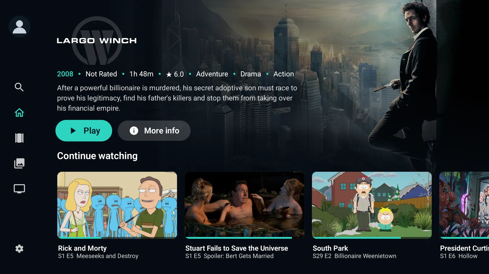
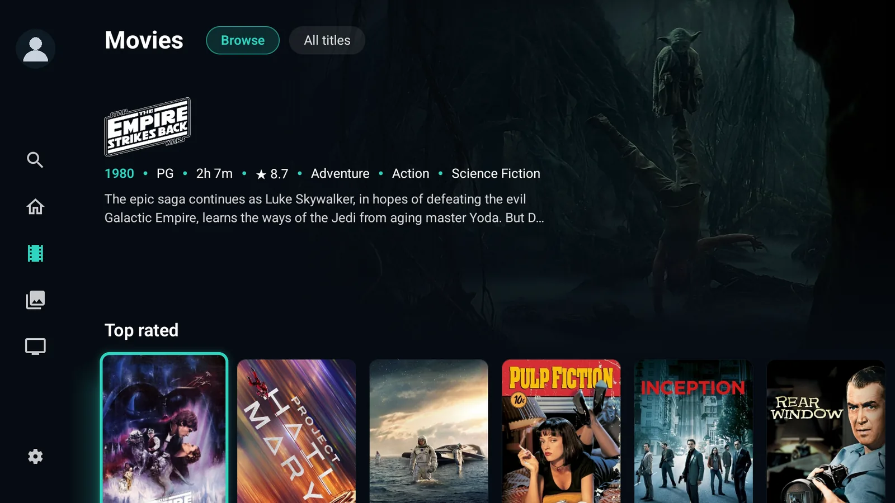
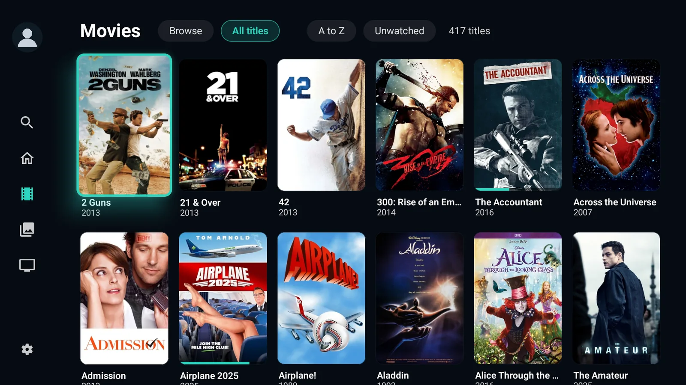
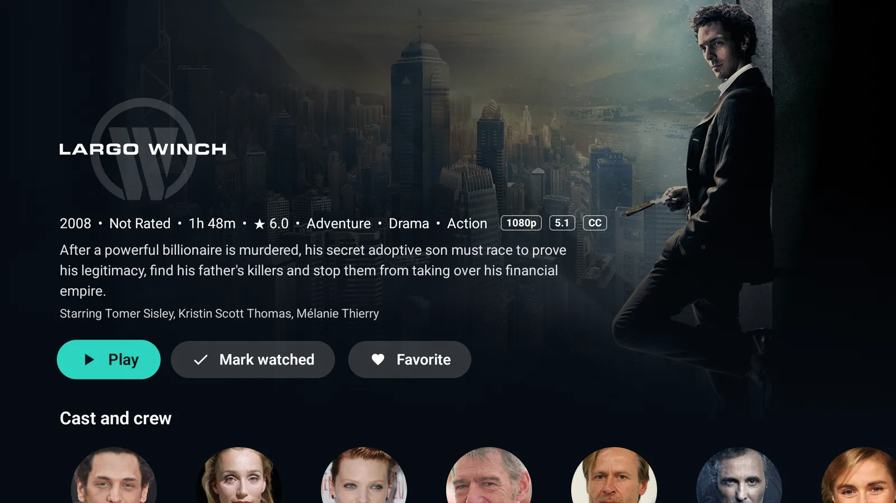
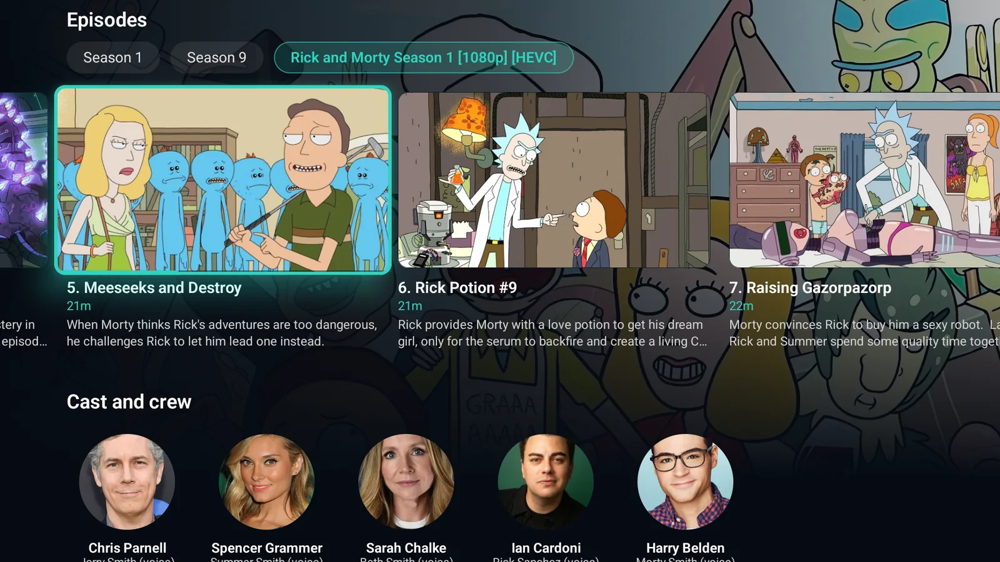
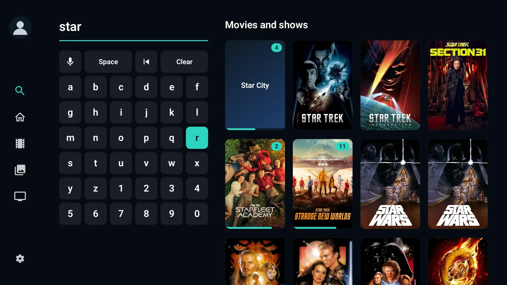
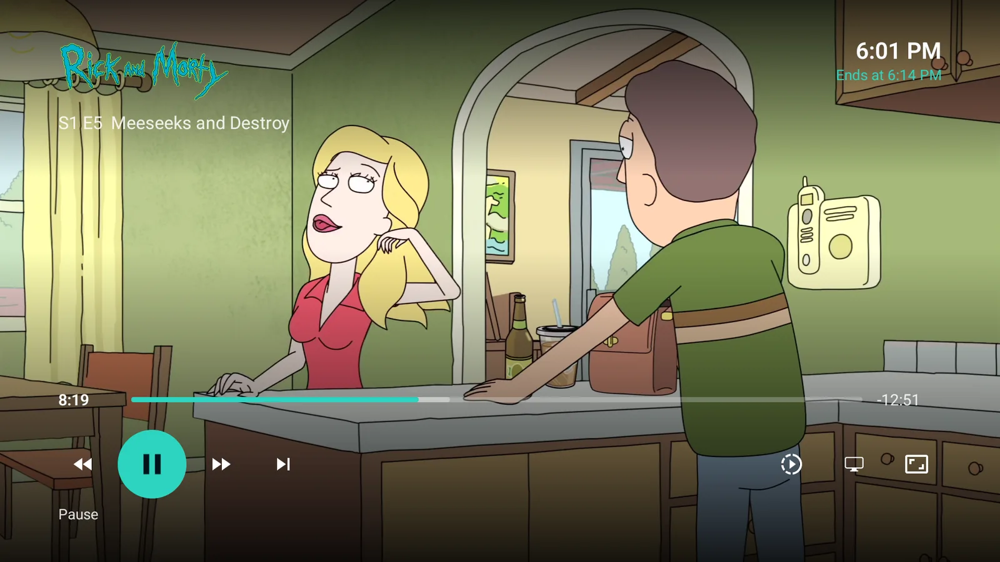

<p align="center">
  
</p>

<h1 align="center">Lagoon</h1>

<p align="center">
  <strong>Your Jellyfin library, the way streaming should feel.</strong><br/>
  A free, open source Jellyfin app for Google TV and Android TV with a Netflix and Plex style interface.
</p>

<p align="center">
  <a href="https://github.com/JTCozart/lagoon-tv/releases/latest/download/lagoon-tv.apk"><strong>Download the APK</strong></a>
  &middot;
  <a href="https://jtcozart.github.io/lagoon-tv/install.html">Install guide</a>
  &middot;
  <a href="https://jtcozart.github.io/lagoon-tv/">Website</a>
</p>

<p align="center">
  
</p>

## What it is

Lagoon is a redesigned interface for the open source
[Jellyfin for Android TV](https://github.com/jellyfin/jellyfin-androidtv) app. It keeps that app's proven playback
engine, server support, sign-in and settings, and replaces the screens you use every day:

- **Home:** a navigation rail, a rotating billboard with Play and More info, and rows for Continue watching, Next up
  and new arrivals that follow your Jellyfin home settings.
- **Libraries:** a Browse view with top rated and genre rows, and an All titles poster wall with sorting and an
  unwatched filter.
- **Details:** artwork, logo, 4K, HDR and surround badges, cast, seasons and episodes, more like this, and a Play
  button that knows whether to resume or which episode is next.
- **Search:** a remote-friendly keyboard and voice search, with the best match first and episodes below.
- **Player controls:** scrub with left and right, see when the title ends, and change audio, subtitles, speed,
  quality, picture size or chapter from side panels.

Lagoon installs beside the official Jellyfin app, so you can keep both.

## Screenshots

| | |
| --- | --- |
|  |  |
|  |  |
|  |  |

## Install

You need a Jellyfin server and a Google TV or Android TV device running Android 6.0 or newer.

1. Allow installing apps from unknown sources on the TV.
2. Get the APK onto the TV with the Downloader app, by sending it from your phone, or with ADB:
   `https://github.com/JTCozart/lagoon-tv/releases/latest/download/lagoon-tv.apk`
3. Open Lagoon, enter your server address, and sign in or use Quick Connect.

The [install guide](https://jtcozart.github.io/lagoon-tv/install.html) covers every method step by step, including
Fire TV, updating and checking the download.

## Build it yourself

```bash
git clone https://github.com/JTCozart/lagoon-tv.git
cd lagoon-tv
./gradlew test
./gradlew assembleDebug
adb install -r app/build/outputs/apk/debug/*.apk
```

You need JDK 21 and the Android SDK. Releases are built by GitHub Actions when a version tag is pushed; see
[CONTRIBUTING.md](CONTRIBUTING.md).

## Contributing

Bug reports, ideas and pull requests are welcome. Please read [CONTRIBUTING.md](CONTRIBUTING.md) first: it covers
where new code goes, the test-first workflow, the code style and how releases work.

## License and credits

Lagoon is a modified version of Jellyfin for Android TV, copyright the Jellyfin contributors, and is licensed under
the [GNU General Public License, version 2](LICENSE). It is an independent project, not affiliated with or endorsed
by the Jellyfin project. Third-party components and their licenses are listed in [NOTICES.md](NOTICES.md).

Made by Jake Cozart at [Cozart Consulting](https://cozartconsulting.com).
